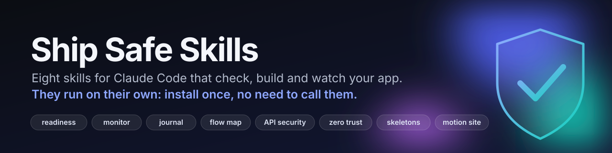
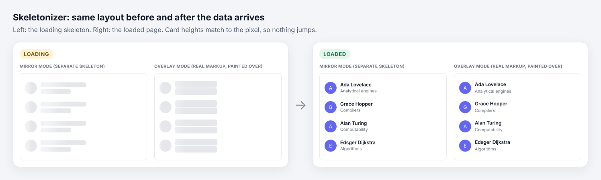
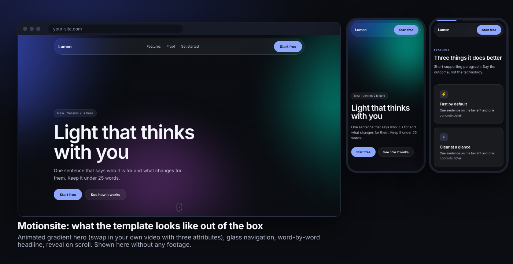
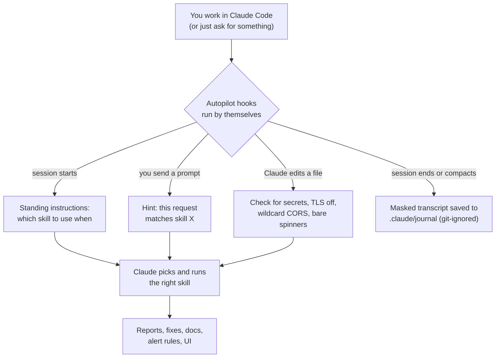
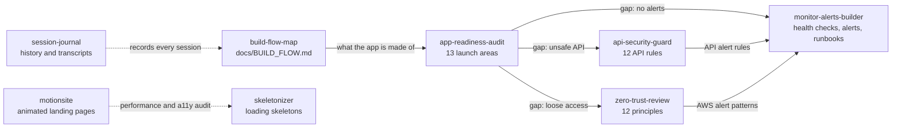

<p align="center">
  
</p>

<p align="center">
  
  
  
  
  
</p>

<p align="center">
  <b>Eight skills that check, build and watch your app. Install once; you never have to call them.</b><br>
  <a href="#quick-start">Quick start</a> ·
  <a href="#the-skills-at-a-glance">The skills</a> ·
  <a href="#when-to-use-what">When to use what</a> ·
  <a href="#see-it-work">See it work</a> ·
  <a href="#autopilot-skills-that-run-on-their-own">Autopilot</a> ·
  <a href="#install-options">Install options</a> ·
  <a href="#faq">FAQ</a>
</p>

---

## What is this?

AI-assisted code ships fast, and it ships with quiet problems: a key pasted into a file, an endpoint anyone can call, a screen that stays blank while data loads, no alert when the server dies. This repository is a set of **skills** (written instructions Claude loads when they apply) plus **autopilot hooks** that make Claude apply them *by itself* while it works.

- **It checks.** Launch-readiness, API security (12 rules) and Zero Trust (12 principles) reviews that read your code and report evidence, not vibes. Scanner scripts run offline and send nothing anywhere.
- **It builds.** Monitoring and alerts, loading skeletons for your existing UI, animated video-hero landing pages, and a map of how your project is built.
- **It remembers.** Every session is saved (secrets masked) so you can look back at what was decided and why.
- **It runs on its own.** With autopilot on, Claude is reminded which skill fits, each file it edits is checked for leaked secrets and risky settings, and your prompts are matched to the right skill. No slash commands to remember.

> [!NOTE]
> Skills are instructions that Claude follows with your permissions. Read what you install. Everything in this repository is plain text and Python you can read in a few minutes; see [Safety, privacy and honest limits](#safety-privacy-and-honest-limits).

## Quick start

In Claude Code:

```text
/plugin marketplace add quiczz/ship-safe-skills
/plugin install ship-safe-skills@ship-safe-skills
```

Restart Claude Code. That is the whole setup: the eight skills and autopilot are now on.

Then ask for something ordinary, for example *"Add a login page and a dashboard that loads the user's projects."* With autopilot on, expect Claude to write the loading state as a skeleton rather than a spinner, check the new auth route against the 12 API rules, and mention in one line anything it spotted, without you naming a skill.

Not using plugins? [Other ways to install](#install-options): one `npx` command, copy the folders, a Python installer, or a zip upload for Claude.ai and Claude Desktop.

## The skills at a glance

| Skill | Use it when | You get | Runs on its own when |
|-------|-------------|---------|----------------------|
| **`app-readiness-audit`** | You are about to launch, or want to know what is missing | A report on 13 areas (mobile, secret keys, database, rate limits, password reset, rollbacks, backups, usage limits, analytics, input cleaning, error handling, log flow, monitoring) with file and line evidence and a fix list | Claude is about to call a feature "ready to ship" |
| **`monitor-alerts-builder`** | You have no alerting, or the audit flagged it | Health check script, alert rules (Prometheus), webhook alerts to Slack/Discord/anything, runbooks | A deploy is being prepared with no alerts |
| **`api-security-guard`** | You have an API, or touch auth and tokens | Endpoint inventory, a check against 12 rules mapped to the OWASP API Top 10 (2023), API-specific alert rules | Claude adds or changes a route, auth or a token |
| **`zero-trust-review`** | You touch cloud, Kubernetes, CI or service accounts, or run AI agents | A review against 12 Zero Trust principles, a 30/60/90-day plan, AWS alert patterns | Claude touches IAM, service accounts, CI secrets or network config |
| **`skeletonizer`** | A screen shows a spinner or a blank area while data loads | Layout-matching skeleton placeholders wired into the loading state, no layout jump | Claude builds UI that fetches data |
| **`motionsite`** | You want an animated, cinematic landing page | A video-hero site (glass nav, animated headline, scroll reveals) that stays fast and accessible, plus an audit script | You ask for a landing page, hero or animated site |
| **`build-flow-map`** | A new developer needs to understand the project | `docs/BUILD_FLOW.md`: stack, commands, env vars, services, routes, and a diagram | Structure changes, or the file is missing |
| **`session-journal`** | You want a record of what was decided | A written journal plus the full chat transcript with secrets masked | Every session end (autopilot) |

## When to use what

| Your situation | Skill | Say something like |
|----------------|-------|--------------------|
| "Is this ready to launch?" | `app-readiness-audit` | *Run a readiness audit and give me the fix list.* |
| "I have no idea if the server is up" | `monitor-alerts-builder` | *Set up monitoring and alerts for this app.* |
| "Can someone read another user's data?" | `api-security-guard` | *List every endpoint and check for broken object-level authorization.* |
| "Our cloud setup feels loose" | `zero-trust-review` | *Do a Zero Trust review and give me a 30/60/90-day plan.* |
| "Pages flash blank before data shows" | `skeletonizer` | *Find every spinner that should be a skeleton and fix them.* |
| "I need a striking landing page" | `motionsite` | *Build an animated landing page with a video background for my product.* |
| "A new teammate is joining" | `build-flow-map` | *Document how this project is built and how to run it.* |
| "What did we decide last week?" | `session-journal` | *Save this session to the journal.* |

You do not need to say any of this when autopilot is on; it is how to ask when you want a full report.

## See it work

**Skeletons that match the page.** The skeleton and the loaded page are the same height to the pixel, so nothing jumps when data arrives:

<p align="center">
  
</p>

**A motion site out of the box.** Animated gradient hero (swap in your own video with three attributes), glass navigation, word-by-word headline, scroll reveals; honors reduced-motion and data-saver settings:

<p align="center">
  
</p>

**Evidence, not opinions.** Real output from the readiness scanner on a small test project with deliberately planted problems (secret values are never printed, only their first characters):

```text
| Severity | Area               | Problem                                                          | Where            |
|----------|--------------------|------------------------------------------------------------------|------------------|
| critical | 2 Secret keys      | A .env file is tracked by git: treat every key in it as leaked   | `.env`           |
| critical | 2 Secret keys      | Stripe live key found in code (starts 'sk_l***'): rotate it      | `src/server.js:3`|
| high     | 3 Database         | SQL built with string concatenation/interpolation                | `src/server.js:9`|
| high     | 11 Error handling  | Error stack/message sent back to the client                      | `src/server.js:16`|
| high     | 12 Log flow        | Logging request bodies/headers or credentials                    | `src/server.js:8`|
```

More real outputs, one per skill, are in [`docs/examples/`](docs/examples): [readiness](docs/examples/app-readiness-audit.txt) · [API inventory](docs/examples/api-security-guard.txt) · [Zero Trust](docs/examples/zero-trust-review.txt) · [build flow](docs/examples/build-flow-map.txt) · [skeleton candidates](docs/examples/skeletonizer.txt) · [motion audit](docs/examples/motionsite-audit.txt) · [autopilot](docs/examples/autopilot.txt).

## Autopilot: skills that run on their own

Skills normally wait to be called. Autopilot is a small set of [Claude Code hooks](https://code.claude.com/docs/en/hooks) in [`hooks/`](hooks) that closes the gap.



| Moment | What happens | Why |
|--------|--------------|-----|
| **Session starts** | Claude gets about a dozen lines: which skill to use for which situation, and project warnings (for example `.env` is not git-ignored, no `docs/BUILD_FLOW.md`) | The skills trigger reliably, not only when you remember them |
| **You send a prompt** | If it mentions launching, alerts, endpoints, zero trust, spinners, landing pages and so on, Claude gets a one-line pointer to the matching skill | A second nudge, only when it is relevant |
| **Claude writes or edits a file** | The file is checked for real-looking secrets (AWS, GitHub, Stripe, Slack, Google, OpenAI/Anthropic keys, private keys, database URLs with passwords), turned-off TLS checks, wildcard CORS and secrets in URLs; `.env` files must be git-ignored; a new bare spinner for content prompts a skeleton | Problems are caught the moment they are written, not at launch |
| **Session ends or is about to be compacted** | The transcript is saved as Markdown with common secret patterns masked | A record that survives context limits |

Each check is deliberately small and quiet:

- It **never blocks** Claude and never fails a session. Findings arrive as a short note that Claude relays in one line.
- It **never prints a secret value**, only the type, file and line.
- Hints are **throttled**: the same finding or hint is not repeated within a session.
- It runs locally, uses only the Python standard library, and makes **no network calls**.

Turn parts off at any time:

```bash
python3 hooks/autopilot.py status
python3 hooks/autopilot.py off journal        # or: context | hints | secrets | all
```

Details, privacy notes and troubleshooting: [`docs/autopilot.md`](docs/autopilot.md). Autopilot works in **Claude Code** (plugin install, or `python3 install.py autopilot on`). Claude.ai and Claude Desktop uploads get the skills only; they still trigger automatically from their descriptions, but there are no hooks there.

## How the skills fit together



The audit finds the gap, the specialist skill goes deep on it, and `monitor-alerts-builder` turns every "we should be told if this happens" into an alert someone will actually receive.

## Each skill in detail

<details>
<summary><b>app-readiness-audit</b>: 13 launch areas, evidence for each</summary>

**Checks:** mobile support · secret keys · database safety · rate limiting · password reset · rollbacks · backups · usage limits · analytics · input cleaning · error handling · log flow · monitoring and alerts.

**How it works:** a scanner (`scripts/scan.py`) collects evidence (secret patterns with values redacted, `.env` hygiene, SQL built by string concatenation, error stacks sent to clients, predictable randomness near reset tokens, and more). Claude then reads the code around each lead, scores every area, and fills in a report template with a prioritized fix list.

**Honest limits:** it reads code; it does not attack a running system. "No signal found" means "not found by pattern", and the report says so.

Files: [`SKILL.md`](skills/app-readiness-audit/SKILL.md) · [checklist](skills/app-readiness-audit/references/checklist.md) · [report template](skills/app-readiness-audit/references/report-template.md) · [scanner](skills/app-readiness-audit/scripts/scan.py)
</details>

<details>
<summary><b>monitor-alerts-builder</b>: so a human is told within minutes</summary>

**Builds:** a stdlib-only health check (`healthcheck.py`: URL, disk, certificate expiry, backup freshness) with webhook alerts and de-duplication; Prometheus alert rules (errors, latency, auth abuse, rate limits, backups, spend, certificates, plus an `api-security` group); a runbook template; and an alert catalog to choose from.

**Principle:** alert on symptoms a person must act on, include context and a next step, and avoid noise. It reuses the monitoring tool you already have instead of adding another.

**Tested:** the health check's `--selftest` and a real webhook delivery. The Prometheus rules are syntax-checked.

Files: [`SKILL.md`](skills/monitor-alerts-builder/SKILL.md) · [alert catalog](skills/monitor-alerts-builder/references/alert-catalog.md) · [`healthcheck.py`](skills/monitor-alerts-builder/templates/healthcheck.py) · [Prometheus rules](skills/monitor-alerts-builder/templates/alert-rules.prometheus.yml) · [runbook](skills/monitor-alerts-builder/templates/runbook-template.md)
</details>

<details>
<summary><b>api-security-guard</b>: 12 rules, every endpoint listed</summary>

| # | Rule | OWASP API Top 10 (2023) |
|---|------|--------------------------|
| 1 | Authenticate every call | API2 Broken Authentication |
| 2 | Check object access | API1 Broken Object Level Authorization, API5 Broken Function Level Authorization |
| 3 | Rate limit | API4 Unrestricted Resource Consumption, API6 Unrestricted Access to Sensitive Business Flows |
| 4 | Validate input | API3 Broken Object Property Level Authorization, API7 Server Side Request Forgery |
| 5 | HTTPS only | API8 Security Misconfiguration |
| 6 | Short-lived tokens | API2 |
| 7 | Least-privilege keys | API5, API8 |
| 8 | No secrets in URLs | API8 |
| 9 | Log auth failures | API8 |
| 10 | Version your API | API9 Improper Inventory Management |
| 11 | Limit response data | API3 |
| 12 | Inventory endpoints | API9, API10 Unsafe Consumption of APIs |

`scripts/api_inventory.py` lists every route (Express and Fastify, FastAPI, Flask, NestJS, Django, Go net/http style routers, and Next.js file routes), shows which have no authentication nearby, which take an object ID (each needs an ownership check), compares code to your OpenAPI file, and flags tokens in URLs, plain `http://`, long-lived tokens and whole-object responses. Monitoring rules for the 12 rules are included.

Files: [`SKILL.md`](skills/api-security-guard/SKILL.md) · [rules](skills/api-security-guard/references/rules.md) · [monitoring](skills/api-security-guard/references/monitoring.md) · [inventory script](skills/api-security-guard/scripts/api_inventory.py)
</details>

<details>
<summary><b>zero-trust-review</b>: 12 principles, evidence from your infrastructure files</summary>

Verify every request · strong identity · MFA everywhere · device health · least privilege · just-in-time access · microsegmentation · encrypt internally · continuous checks · log everything · assume breach · service identity.

Mapped to NIST SP 800-207 and the CISA Zero Trust Maturity Model. `scripts/zt_scan.py` reads Terraform/CloudFormation, Kubernetes, Docker and CI files and reports good signs and risks per principle (wildcard IAM actions, long-lived keys, privileged containers, missing network policies, unpinned CI actions, and more); where the repo cannot answer, it lists the question to ask the owner. The skill produces a 30/60/90-day roadmap, includes 10 AWS EventBridge/CloudTrail alert patterns, and has a section on securing AI agents and service accounts.

**Honest limit:** the AWS patterns follow documented event shapes but were not run in a live AWS account. Test them in yours.

Files: [`SKILL.md`](skills/zero-trust-review/SKILL.md) · [principles](skills/zero-trust-review/references/principles.md) · [agents](skills/zero-trust-review/references/agents.md) · [monitoring](skills/zero-trust-review/references/monitoring.md) · [AWS patterns](skills/zero-trust-review/templates/aws-eventbridge-patterns.json) · [scanner](skills/zero-trust-review/scripts/zt_scan.py)
</details>

<details>
<summary><b>skeletonizer</b>: loading skeletons for the UI you already have</summary>

Finds where users see a spinner, a blank area or "Loading..." (`scripts/find_loading_candidates.py`), then builds skeletons in one of two modes:

- **Mirror:** a separate skeleton component with the same layout as the real one. Best for routes and lists.
- **Overlay:** the real markup is painted grey with CSS while `data-loading` is set. Best for small components; zero layout drift.

Works with React, Next.js (`loading.tsx` and `<Suspense>`), Remix/React Router, Vue/Nuxt, SvelteKit, Angular, plain HTML, Flutter, SwiftUI and React Native. Handles dark mode, reduced motion, screen readers (`aria-busy`), and a delay so fast loads never flash. Includes a React primitive set, a `useDelayedLoading` hook and a demo page.

**Tested:** the CSS and demo in Chromium (no layout shift, reduced motion, dark mode, phone width), the delay hook's timing, and the scanner against test projects with planted problems.

Files: [`SKILL.md`](skills/skeletonizer/SKILL.md) · [framework recipes](skills/skeletonizer/references/frameworks.md) · [UI anatomy](skills/skeletonizer/references/anatomy.md) · [CSS](skills/skeletonizer/templates/skeleton.css) · [React](skills/skeletonizer/templates/Skeleton.tsx) · [demo](skills/skeletonizer/templates/demo.html)
</details>

<details>
<summary><b>motionsite</b>: animated video-hero landing pages, built to stay fast and accessible</summary>

Builds the "motion site" look: full-bleed looping video (or an animated gradient until you have footage), a gradient overlay for readable text, glass cards, a staggered headline, buttons that react, scroll reveals. Then it audits itself.

- **Template:** one self-contained `site.html`, plus React `Hero.tsx` and `useReveal.ts`.
- **Video done properly:** muted, inline, poster as first paint, never downloaded for visitors with reduced motion or data saver, paused when off screen, with a visible pause button.
- **`make_video_assets.sh`:** ffmpeg to web mp4, webm and poster, optional seamless loop cross-fade.
- **`check_motion.py`:** audits a site folder for missing poster/muted/playsinline, huge or audio-carrying video, animations that move layout properties, no reduced-motion handling, scroll listeners that block, `100vh` heroes, hidden-until-JS content and more. Exit code 1 on failures, so it works in CI.

Not affiliated with motionsites.ai; no third-party prompts or assets are included.

**Tested:** in Chromium with a real video: plays, pauses on scroll and on button, not requested under reduced motion, readable with JavaScript off, no horizontal overflow at 375 px.

Files: [`SKILL.md`](skills/motionsite/SKILL.md) · [design recipes](skills/motionsite/references/design-recipes.md) · [performance and accessibility](skills/motionsite/references/performance-accessibility.md) · [assets](skills/motionsite/references/assets.md) · [template](skills/motionsite/templates/site.html)
</details>

<details>
<summary><b>build-flow-map</b>: one document that answers a new developer's first questions</summary>

`scripts/scan_stack.py` reads manifests, scripts, route files, Dockerfiles and CI config; Claude then writes `docs/BUILD_FLOW.md`: languages and frameworks, run/test/deploy commands, entry points, **environment variable names** (values are never read), databases and external services, API routes, CI/CD, and a request-flow diagram. A CI snippet in `references/keeping-it-current.md` fails the build when the document drifts from the code.

Files: [`SKILL.md`](skills/build-flow-map/SKILL.md) · [template](skills/build-flow-map/references/build-flow-template.md) · [keeping it current](skills/build-flow-map/references/keeping-it-current.md) · [scanner](skills/build-flow-map/scripts/scan_stack.py)
</details>

<details>
<summary><b>session-journal</b>: a written history of your sessions</summary>

Two layers: Claude writes a short journal (goals, decisions and why, files changed, open items), and `scripts/export_transcript.py` converts the full chat transcript to Markdown with common secret patterns masked. With autopilot on the transcript is saved automatically at session end and before compaction, to `.claude/journal/transcripts/` (which carries its own `.gitignore`, so it is never committed by accident).

**Honest limit:** masking catches common patterns, not everything. Treat transcripts as private.

Files: [`SKILL.md`](skills/session-journal/SKILL.md) · [exporter](skills/session-journal/scripts/export_transcript.py)
</details>

## Install options

| Option | Command | Autopilot | Best for |
|--------|---------|:---------:|----------|
| **A. Claude Code plugin** | `/plugin marketplace add quiczz/ship-safe-skills` then `/plugin install ship-safe-skills@ship-safe-skills` | yes | Most people |
| **B. Skills CLI** | `npx skills add quiczz/ship-safe-skills` | no | Installing into several coding agents |
| **C. Copy folders** | `cp -r skills/* ~/.claude/skills/` | no | No tools, full control |
| **D. Installer** | `python3 install.py install --own` (asks about autopilot) | yes | Non-plugin Claude Code, plus optional third-party skills |
| **E. Claude.ai / Desktop** | Download a skill zip from [Releases](../../releases), then Settings, Capabilities, Skills, Upload | no | Chat apps without Claude Code |

Update, uninstall and troubleshooting for each option: [`docs/install.md`](docs/install.md). Use **either** the plugin **or** `install.py autopilot on`, not both, or every check runs twice.

## Optional: third-party skills (installer only)

`install.py` can also download popular design, diagram and security skills straight from their authors' GitHub repos, pinned to the exact commit that was reviewed. This repo does **not** copy or redistribute them; each keeps its own license ([THIRD_PARTY.md](THIRD_PARTY.md)).

```bash
python3 install.py list
python3 install.py install hallmark impeccable ui-ux-pro-max
python3 install.py install --all          # everything (about 80 MB; asks first)
```

<details>
<summary>What is available</summary>

| Name | Installed from | Notes |
|------|----------------|-------|
| rea | morluto/rea | Needs the REA tool for full use. Lighter option: aicodeking/leanrea |
| security-auth | harperaa/secure-claude-skills | 11 skills built around Clerk / Next.js / Convex |
| stitch | google-labs-code/stitch-skills | Needs the Stitch MCP server |
| interface-design | Dammyjay93/interface-design | |
| scroll-world | oso95/scroll-world | Costs money to generate assets; needs ffmpeg |
| frontend-slides | zarazhangrui/frontend-slides | |
| website-cloner | JCodesMore/ai-website-cloner-template | Only clone sites you have the right to copy |
| hallmark | Nutlope/hallmark | |
| diagram-design | cathrynlavery/diagram-design | |
| archify | tt-a1i/archify | |
| taste-skill | Leonxlnx/taste-skill | |
| ui-ux-pro-max | nextlevelbuilder/ui-ux-pro-max-skill | |
| awesome-design-md | VoltAgent/awesome-design-md | 84 brand DESIGN.md files plus a wrapper skill from this repo |
| impeccable | pbakaus/impeccable | |
| web-design-guidelines | vercel-labs/agent-skills | Fetches the latest rules from the web each run |
| playwright-mcp | microsoft/playwright-mcp | An MCP server, not a skill. `--with-mcp` registers it |
| aisoc | beenuar/AiSOC | **Not installed**: a full self-hosted security platform, not a skill. Its MCP server connects Claude to your own running AiSOC |

Some names matched several projects; these are the picks. Change `repo` in `skills.json` if you meant another.
</details>

## Safety, privacy and honest limits

- **Read before you trust.** A skill is instructions with your permissions. Scripts here use only the Python standard library, make no network calls, and write only where stated (`~/.claude/ship-safe-skills/`, and `.claude/journal/` in your project when the journal is on).
- **Scanners find leads, not proof.** They are pattern-based. Apps with custom auth wrappers will show false alarms, and "nothing found" is not "safe". None is a penetration test and none sends traffic to a live system.
- **Autopilot never blocks and never prints secret values.** It adds a short note for Claude; you stay in control of what changes.
- **Transcripts are private data.** The exporter masks common secret patterns but cannot catch everything; transcripts go to a git-ignored folder. Switch the journal off with `python3 hooks/autopilot.py off journal`.
- **Tested here:** scanners against planted-flaw test projects and large real-world repositories; the browser pieces in Chromium; the hooks and installer against synthetic sessions and a real Claude Code plugin install. **Not tested:** the AWS alert patterns in a live AWS account, the hooks on Windows, and the plugin on every Claude Code version.
- **Third-party skills** pinned by the installer were checked only to confirm they install and contain a `SKILL.md`; they were not security-audited.

## Repository layout

```text
ship-safe-skills/
├── .claude-plugin/        plugin.json, marketplace.json   (Claude Code plugin marketplace)
├── hooks/                 hooks.json + autopilot.py       (the "runs on its own" layer)
├── skills/                the 8 skills, one folder each (SKILL.md + references/ scripts/ templates/)
├── wrappers/              small wrapper skill for the optional awesome-design-md download
├── docs/                  autopilot.md, install.md, skills.md, PUBLISHING.md, examples/, assets/
├── tools/                 validate.py, build_release.py, set_owner.py
├── install.py             installer (skills, optional third-party skills, autopilot on/off)
├── skills.json            manifest: own skills, pinned third-party sources
├── .github/               CI, release workflow, issue and PR templates
└── THIRD_PARTY.md, LICENSE, CHANGELOG.md, CONTRIBUTING.md, SECURITY.md
```

## FAQ

**Do I have to type commands to use the skills?** No. With autopilot on (plugin install, or `install.py autopilot on`) Claude is told when each skill applies and picks them itself. You can still ask for a full report in plain words.

**Will it slow Claude down or fill the context?** Session start adds about a dozen lines; each edit adds a note only when something was found. The hooks themselves finish in well under a second.

**Does anything leave my machine?** No. There are no network calls. The installer downloads optional third-party skills only when you ask for them.

**Will it block me or rewrite my code?** Autopilot never blocks. Skills that build things (skeletons, monitoring, docs) edit files as part of the task you asked for; use a clean git branch and review the diff.

**Does it work with other AI coding tools?** The `SKILL.md` format is shared by several agents, so `npx skills add` and copying folders can work elsewhere, but autopilot hooks are Claude Code only.

**Claude.ai says my skill zip is invalid.** The zip must contain the skill folder at its root (use the per-skill zips from Releases, not a zip of the whole repo).

**I installed both the plugin and `autopilot on`.** Run `python3 install.py autopilot off` to keep the plugin only.

**How do I add my own check to the file scanner?** Add a pattern to `RISKY` or `SECRET_PATTERNS` in [`hooks/autopilot.py`](hooks/autopilot.py) and run `python3 tools/validate.py`.

## Contributing

Issues and pull requests are welcome; see [CONTRIBUTING.md](CONTRIBUTING.md). Run `python3 tools/validate.py` before you open a PR. To report a security problem privately, see [SECURITY.md](SECURITY.md). Publishing your own copy of this repo: [`docs/PUBLISHING.md`](docs/PUBLISHING.md).

## Standards and credits

[OWASP API Security Top 10 (2023)](https://owasp.org/API-Security/editions/2023/en/0x00-header/) · [NIST SP 800-207 Zero Trust Architecture](https://csrc.nist.gov/pubs/sp/800/207/final) · [CISA Zero Trust Maturity Model](https://www.cisa.gov/zero-trust-maturity-model) · [Claude Code skills](https://code.claude.com/docs/en/skills) and [plugins](https://code.claude.com/docs/en/plugins). Optional third-party skills belong to their authors; see [THIRD_PARTY.md](THIRD_PARTY.md).

## License

MIT for everything written for this repository ([LICENSE](LICENSE)). Third-party skills keep their own licenses.
