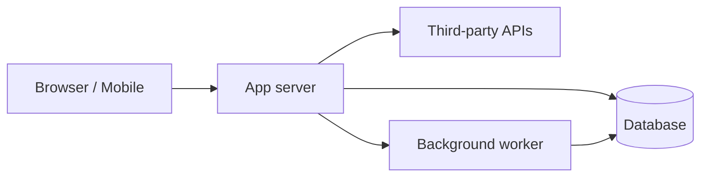
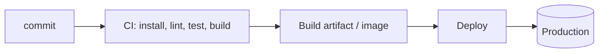

# {{Project name}}: Build Flow

Last scanned: {{date}} at commit {{short sha}}. Facts below came from {{manifest/CI files}}; items marked *Unverified* were inferred.

## 1. What this is
One paragraph: what the product does and who uses it.

## 2. Stack at a glance
| Layer | Technology | Where defined |
|-------|-----------|---------------|
| Language(s) | | |
| Framework(s) | | `package.json` / `pyproject.toml` ... |
| Database | | |
| Auth | | |
| Hosting / runtime | | |
| CI/CD | | |

## 3. Run it locally
```bash
# prerequisites: {{runtime versions}}
# install
# configure: copy .env.example to .env and fill in the variables in section 6
# run
# test
```

## 4. How the pieces connect (runtime)

Walk one real request through it in 4 to 6 numbered steps, with file paths.

## 5. Entry points and routes
| Entry point / route | File | Purpose |
|--------------------|------|---------|

## 6. Environment variables (names only)
| Name | Required | Used in | Purpose |
|------|:--------:|---------|---------|

## 7. External services
| Service | Used for | Config / SDK location |
|---------|----------|-----------------------|

## 8. Build and release flow

Commands and triggers, how to roll back (link to runbook).

## 9. Project layout
Short tree of the top 2 levels with one line per folder.

## 10. Unverified / open questions
- ...

## How to update this file
Run `python3 <skill-dir>/scripts/scan_stack.py . --format markdown`, compare with the sections above, and update what changed in the same pull request.
